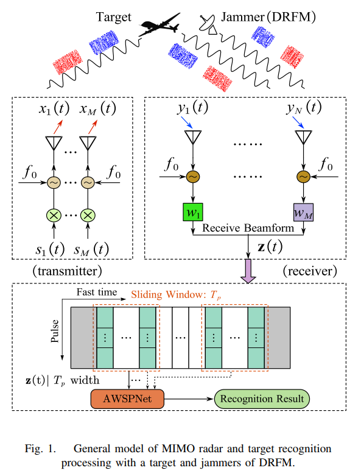
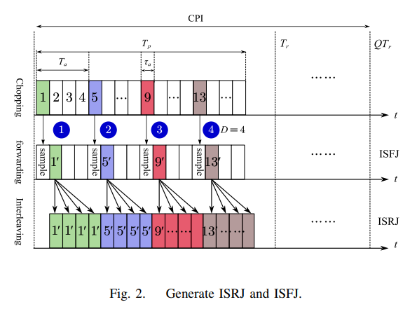
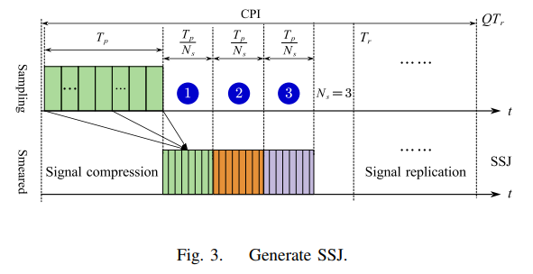
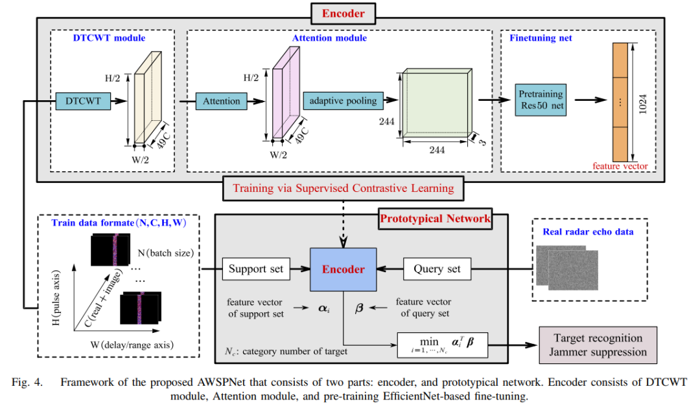
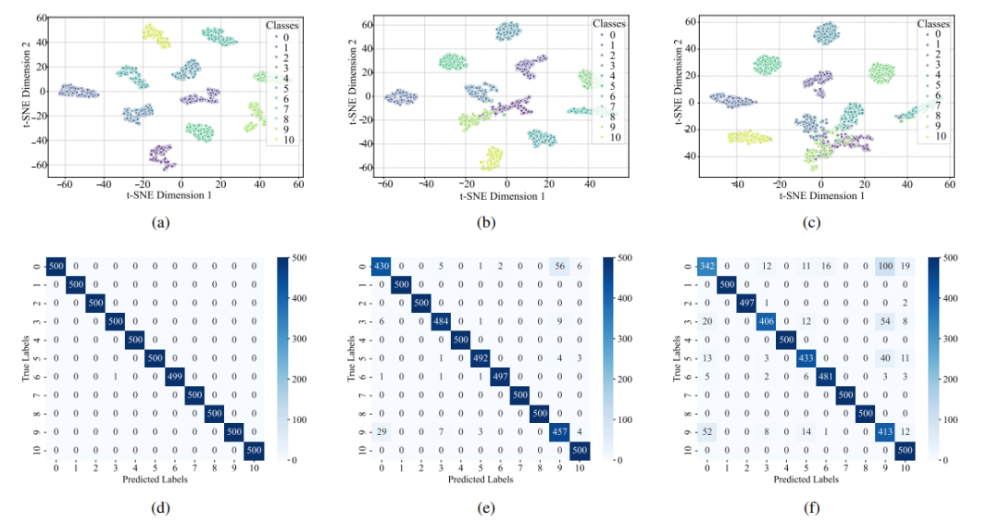
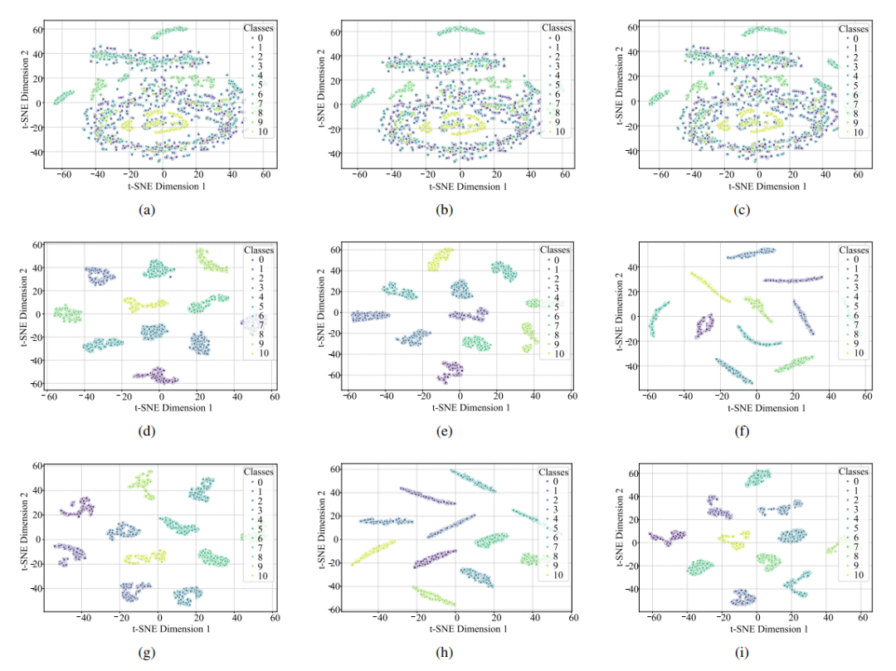
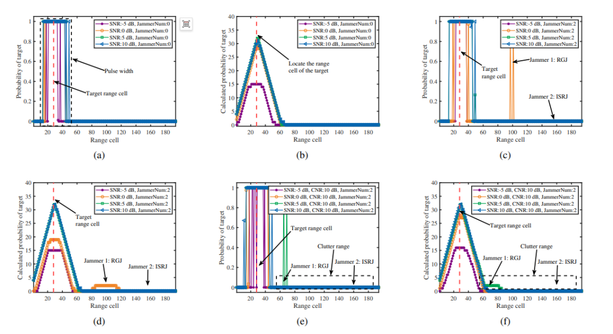

# [Anti-Interference]Low SNR Environment Stabilized! AWSPNet Empowers MIMO Radar for Precise Target Identification + Reduction of DRFM Interference [with Python code attached]

Personal Blog: https://www.cnblogs.com/EWFrontier  
✿Low SNR environment stabilized! AWSPNet empowers MIMO radar for precise target recognition and suppression of DRFM interference ✿1. Article title: Application of the Attention-based Dual Tree Wavelet Scattering Prototype Network (AWSPNet) in MIMO Radar Target Recognition and Interference Suppression
2. Abstract: The electronic countermeasure technology based on Digital Radio Frequency Memory (DRFM) is developing rapidly, posing a significant threat to the survivability and combat effectiveness of radar systems. Such jammers can generate a large number of deceptive pseudo targets that exceed the radar's processing capabilities and obscure real targets. Therefore, in low signal-to-noise ratio (SNR) environments, the ability to robustly distinguish real targets from complex interference signals is crucial. This paper proposes an Attention-based Dual Tree Wavelet Scattering Prototype Network (AWSPNet), a deep learning framework for simultaneous implementation of radar target recognition and interference suppression.
The core of AWSPNet is the encoder, which utilizes the dual tree complex wavelet transform (DTCWT) to extract features inherently robust to noise and signal translation. These features are further optimized through attention mechanisms and pre-trained backbone networks. To address the issue of limited labeled data and improve generalization capabilities, a supervised contrastive learning strategy is employed during training; classification tasks are completed by the prototype network, which performs exceptionally well in scenarios with few samples and can quickly adapt to new signal types.
Extensive experiments have validated the effectiveness of the proposed method: at -6 dB SNR, AWSPNet achieves a recognition accuracy of 90.45%; t-SNE visualization provides a physical interpretation of the network's internal working mechanism; a complete algorithm combining AWSPNet with a time-domain sliding window method is proposed, capable of identifying various types of interference and effectively suppressing it, demonstrating its potential for practical application in complex electromagnetic environments.
Keywords: MIMO radar; Dual Tree Wavelet Transform; Prototype Network; Interference Identification; Transformer
3. Introduction The operational effectiveness of modern radar systems is under severe threat from advanced electronic countermeasures, particularly interference technology based on digital radio frequency memory (DRFM) [1]-[5]. DRFM jammers can coherently intercept, alter, and forward radar signals to generate dense and realistic decoy targets, significantly reducing radar performance. This technology confrontation highlights the urgent need for precise target discrimination and effective interference suppression in complex electromagnetic environments [6]. This paper aims to develop a unified framework that can reliably distinguish between targets and deceptive interference signals.
The task of interference recognition has been widely studied, evolving from traditional signal processing to modern deep learning. Traditional methods mainly rely on manual feature extraction from time-frequency domains, such as signal domain, and then input into machine learning classifiers like support vector machines or decision trees [7]. For example, literature [8] uses time-frequency features to achieve intelligent identification of complex interference, but these methods often perform poorly in complex and flexible composite interference scenarios, lacking sufficient robustness and generalization capability due to handcrafted features.
In recent years, deep learning (especially convolutional neural networks (CNN)) has become the mainstream paradigm for interference recognition due to its ability to automatically learn hierarchical features from raw or lightly processed data [9]. Numerous studies have adopted CNN architectures like ResNet [10] and DenseNet [11] to achieve high accuracy in interference classification based on time-frequency representations [12]-[15]. To address data dependency and noise sensitivity issues, recent research explores more sophisticated approaches: literature [16] proposes incorporating prior knowledge from interpretable scattering center layers to guide neural networks in improving radar target recognition performance under data incompleteness and low SNR conditions; literature [17] combines wavelet scattering networks with ensemble learning for deceptive interference recognition, achieving good interpretability and few-shot adaptability; literature [18] introduces the PSPNet prototype network, achieving robust interference recognition under few-label samples through pre-training and self-supervised fine-tuning.
However, existing methods still face three major challenges: firstly, the lack of generalization capability significantly degrades performance under conditions where signal parameters change unevenly across training sets or in low SNR (Signal-to-Noise Ratio) scenarios [19]; secondly, the issue of scarcity of samples is prominent, as collecting and labeling interference signals in real-world scenarios is difficult, leading to the dilemma of few-shot learning and easily causing overfitting; thirdly, the "black box" problem of deep learning models, which lack interpretability in their decision-making process, hinders their application in critical defense fields.
To address these limitations, this paper proposes the Attention Mechanism Dual Tree Wavelet Scattering Prototype Network (AWSPNet), designed for robust MIMO radar target recognition and interference suppression. This architecture integrates the advantages of wavelet analysis, attention mechanisms, and metric-based few-shot learning: Firstly, through the Dual Tree Complex Wavelet Transform (DTCWT) module, the raw radar data is transformed into a robust feature representation. Compared to standard discrete wavelet transform, DTCWT has near-translation invariance and better directional selectivity, reducing the sensitivity of features to signal translation and noise; subsequently, the attention module dynamically weights features to focus on key signal information; core feature extraction is completed by a pre-trained EfficientNetV2[24] backbone network, and supervised contrastive learning objectives are used for fine-tuning, enabling clustering of similar sample features and separation of dissimilar sample features, enhancing feature separability; finally, a prototype network[18] replaces traditional linear classifiers to adapt to few-shot scenarios, strengthening the generalization ability for minority signal categories.
The core architecture of AWSPNet consists of an encoder (feature extraction) and a prototype network (classification and few-shot adaptation), combined with a time-domain sliding window for integrated target recognition and interference suppression. The specific design is as follows:
1. The overall framework's encoder is responsible for converting the fast and slow time matrices of radar echoes into high-discriminative feature vectors. The prototype network then classifies based on this feature vector, ultimately achieving interference suppression through a time-domain sliding window algorithm without pulse compression preprocessing, retaining the original echo's time-frequency information.
2. Core module details
Double Tree Wavelet Scattering Network (DTWSN): Based on the Double Tree Complex Wavelet Transform (DTCWT), it extracts the low-frequency approximation and high-frequency details features of signals through predefined wavelet filters. It possesses near-translation invariance and noise resistance, can stably characterize the distorted signals of fast moving targets, and has a low computational complexity (no need to learn filter coefficients from data).
✧  
Attention Module: Dynamically weighting the initial features extracted by DTCWT to enhance the key information of signals and suppress irrelevant noise, especially guiding the model to focus on the effective feature regions in low SNR environments.
✧  
Pre-trained Backbone Networks vs Supervised Contrastive Learning: Utilize pre-trained EfficientNetV2 as a deep feature extractor, reusing the universal features from large-scale datasets through transfer learning to reduce the need for radar domain label data; employ supervised contrastive learning loss during training, forcing similar samples to cluster their features and dissimilar samples to be distant from each other, thereby constructing a high-discriminability feature embedding space.
✧  
Prototype Network: Supports prototype centers for various categories of learning, where query samples are classified by calculating the distance from the prototype center. It is particularly suitable for scenarios with few samples, enhancing the ability to quickly adapt to new types of signals.
3. Target Identification and Interference Reduction Scheme: The target is treated as a single category, while all interference/clutter is considered another category. A time-domain sliding window is used to segment the echo matrix, and the probability of each segment's target type is output through AWSPNet. The probability sequence is then convolved with a rectangular pulse width equivalent, with the peak position representing the distance unit of the target. Isolated interference probability peaks are smoothed and suppressed, ultimately achieving simultaneous completion of target localization and interference reduction.
V. Conclusion This paper proposes the AWSPNet deep learning framework, specifically designed for MIMO radar target recognition and interference suppression in complex electromagnetic environments. It integrates four core capabilities: robust feature extraction through DTCWT, attention mechanism for feature optimization, pre-training network representation learning, and prototype network few-shot classification. The goal is to achieve high recognition accuracy, strong generalization capability, noise resistance, and practical deployment.
Experimental results validate the effectiveness of AWSPNet: ablation experiments show that the integration of DTCWT module, attention mechanism, and pre-trained weights is key to performance in low SNR environments, achieving an accuracy of 90.45% at -6 dB SNR; t-SNE visualization reveals a strong correlation between feature separability and classification accuracy, confirming the necessity of a complete architecture for effective feature separation; integrating AWSPNet with time-domain sliding windows achieves integrated target recognition, localization, and interference suppression, maintaining robust performance even in scenarios with low SNR, clutter, or unseen types of interference.
This framework provides a new solution for MIMO radars to deal with DRFM-type complex interference, its strong noise resistance and few-shot adaptability make it have broad application prospects in real complex electromagnetic environments.
★

## Images

<!-- PAYMENT_BLOCK -->

## Get this dataset

- Payment link (Stripe): [Buy now](https://buy.stripe.com/3cs8yP7sY87d0vu9AB)
- Payment QR code: 

<!-- /PAYMENT_BLOCK -->
